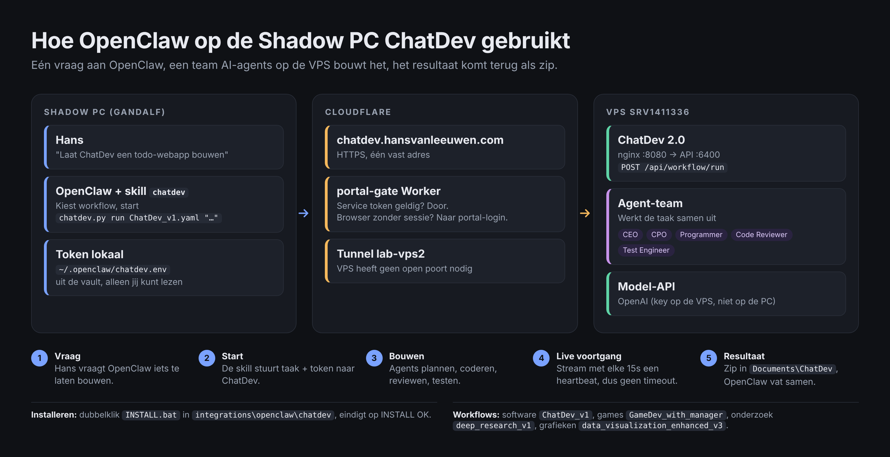

# ChatDev skill for OpenClaw (Shadow PC)

Lets the OpenClaw agent on the Shadow PC start ChatDev runs on the VPS and bring back the result.



## Install (once)
1. Download this folder: https://download-directory.github.io/?url=https://github.com/jowikroon/ChatDev/tree/main/integrations/openclaw/chatdev
   (or `git clone https://github.com/jowikroon/ChatDev` and open `integrations\openclaw\chatdev`).
2. Double-click `INSTALL.bat`. It:
   - copies the client to `C:\AI\chatdev-client`,
   - reads the portal-gate service token from the vault (`SecondBrainVault\_skill\adapters\.env`,
     keys `CF_ACCESS_CLAUDE_CLIENT_ID` / `CF_ACCESS_CLAUDE_CLIENT_SECRET`) into
     `%USERPROFILE%\.openclaw\chatdev.env`, readable only by you, values never shown,
   - installs the skill in `%USERPROFILE%\.openclaw\workspace\skills\chatdev` and `...\.openclaw\skills\chatdev`,
   - checks the connection and writes `install-report.txt` (must end with `INSTALL OK`).
3. Restart the OpenClaw gateway or start a new session.

Vault somewhere else? Set `HANSOS_VAULT` to the vault folder before running `INSTALL.bat`.

## Use
Ask OpenClaw for example: "Laat ChatDev een simpele todo-webapp bouwen". The agent runs:

```
python C:\AI\chatdev-client\scripts\chatdev.py run ChatDev_v1.yaml "<task>" --out %USERPROFILE%\Documents\ChatDev
```

Results land as `chatdev_<session_id>.zip` in `Documents\ChatDev`.

## How it connects
Shadow PC -> `https://chatdev.hansvanleeuwen.com` (Cloudflare) -> portal-gate Worker checks the
service token -> tunnel `lab-vps2` -> ChatDev web/API on the VPS. Runs stream over SSE with a
heartbeat every 15s, so runs longer than Cloudflare's 100s idle limit stay connected.

## Tests
`python tests/test_client.py` (fake server, no network).
